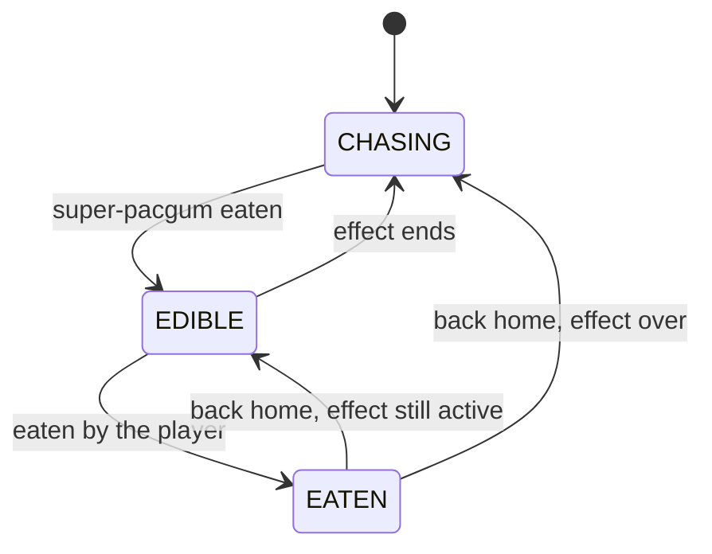
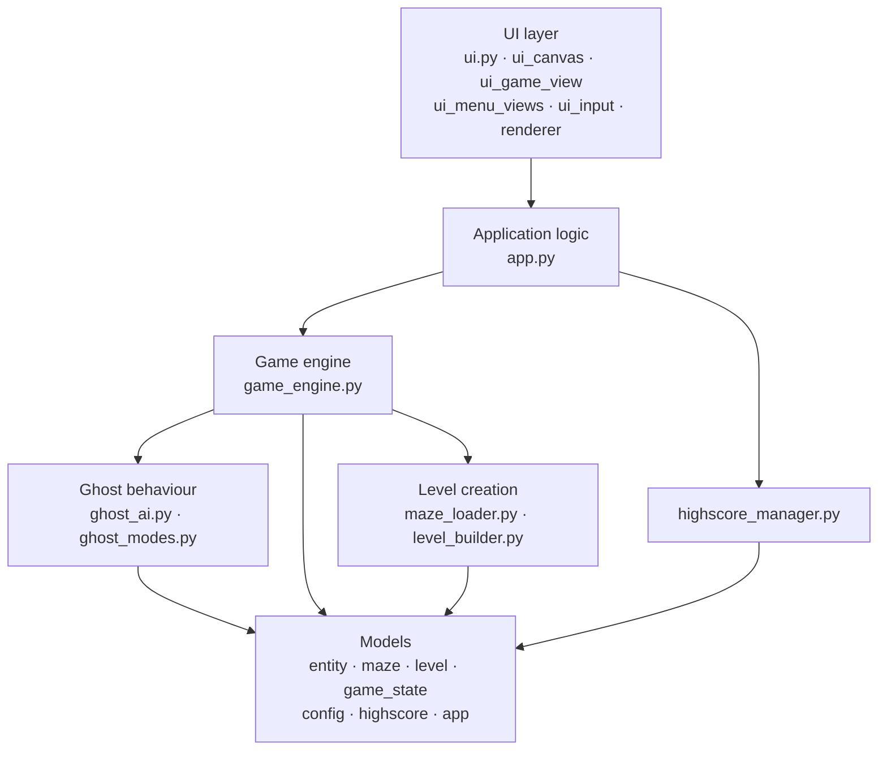

*This project has been created as part of the 42 curriculum by dzhambal, jaatif-a.*

<div align="center">

# 🟡 Pac-Man — Ghosts! More ghosts!

**A Pac-Man game with random mazes, ghost personalities and a neon retro look.**


</div>

---

## 📑 Table of contents

- [Description](#-description)
- [Instructions](#-instructions)
- [Configuration](#-configuration)
- [Highscore](#-highscore)
- [Maze Generation](#-maze-generation)
- [Implementation](#-implementation)
- [General Software Architecture](#-general-software-architecture)
- [Project Management](#-project-management)
- [Resources](#-resources)

---

## 📖 Description

This project is a complete **Pac-Man** game written in Python. The player
moves through a maze, eats every pacgum to complete the level and avoids the
ghosts. The mazes are **randomly generated** by the A-Maze-ing package, so no
two games are the same.

The goal of the project is to build a full game with a clean separation
between **game rules**, **application logic** and **graphics**. The rules
know nothing about the screen, so the graphics library can be replaced
(for example by MiniLibX) by rewriting only a few modules.

### ✨ Features

- 🧩 **Random mazes**, one per level, with an optional fixed seed.
- 👻 **Four ghosts with their own personality**, based on the original game:
  Blinky, Pinky, Inky and Clyde.
- 🔁 **Scatter / chase rhythm**: ghosts alternate between going to their
  corner and hunting the player.
- 🔵 **Super-pacgums**: ghosts turn blue and edible. A ghost that is eaten
  becomes a pair of **eyes**, runs home, and comes back still blue if the
  effect has not ended.
- 😡 **Angry Blinky**: when few pacgums are left he becomes faster and never
  stops chasing.
- 💀 **Death animation** that freezes the game while it plays.
- ⏱️ **Time limit per level**: running out of time costs a life.
- 🏆 **Persistent highscores** with name entry.
- ⏸️ **Pause screen** with resume and return to the main menu.
- 🕹️ **Cheat mode** for testing and demonstrations.
- 🎬 **Smooth continuous movement** along the corridors, not cell by cell.

---

## 🚀 Instructions

### Requirements

- Python **3.12**
- `pygame`
- A graphical environment (a display is needed to open the window)

### Installation

```bash
git clone <repository-url>
cd <repository-name>
make install        # or: pip install -r requirements.txt
```

### Run

```bash
make run            # or: python3 pacman.py config.json
```

### Other useful commands

```bash
make lint           # flake8 + mypy
make clean          # remove caches and temporary files
```

> 📝 Adapt the commands above to the real `Makefile` and entry point of the
> repository.

### 🎮 Controls

| Key | Action |
|---|---|
| `↑` `↓` `←` `→` / `W` `A` `S` `D` | Move (and navigate menus) |
| `Enter` | Confirm |
| `P` or `Esc` | Pause / resume |
| `M` *(while paused)* | Return to the main menu |
| `Backspace` | Erase a letter (name entry) |

### 🧪 Cheat mode

Press `F1` (or `1`) to enable the cheat mode, then:

| Key | Cheat |
|---|---|
| `F2` / `2` | Invincibility (ghosts and timer cannot take lives) |
| `F3` / `3` | Freeze the ghosts |
| `F4` / `4` | Double player speed |
| `F5` / `5` | Skip the current level |
| `F6` / `6` | Add one extra life |

The number keys exist for keyboards where the function keys need `Fn`. They
only work during a game, because on the name screen digits are text.

### 📜 Rules

- Eat **all the pacgums** to complete a level. Finish all the levels to win.
- **Super-pacgums** make the ghosts edible for a short time.
- Touching a normal ghost costs a **life**. Eating a blue ghost gives points.
- Each level has a **time limit**. When it ends you lose a life.
- The game is over when you have no lives left.

---

## ⚙️ Configuration

The game reads a configuration file at start-up. Every value that changes
the gameplay lives there, so the game can be tuned without touching the code.

> 📝 Fill in the real file format and default values of your project.

### General settings

| Key | Description | Default |
|---|---|---|
| `lives` | Lives at the start of the game | `<default>` |
| `player_speed` | Player speed, in cells per second | `<default>` |
| `ghost_speed` | Base ghost speed, in cells per second | `<default>` |
| `level_max_time` | Seconds available per level | `<default>` |
| `points_per_pacgum` | Score for a pacgum | `<default>` |
| `points_per_super_pacgum` | Score for a super-pacgum | `<default>` |
| `points_per_ghost` | Score for eating a ghost | `<default>` |
| `super_pacgum_duration` | Seconds the ghosts stay edible | `<default>` |
| `ghost_respawn_delay` | Seconds an eaten ghost waits at home | `<default>` |
| `highscore_filename` | File where the highscores are stored | `<default>` |
| `levels` | List of levels (see below) | `<default>` |

### Level settings

Every entry of `levels` describes the maze of one level:

| Key | Description |
|---|---|
| `seed` | Maze seed. `0` means a random maze every time |
| `<width / height>` | Size of the maze |

### Example

```json
{
  "lives": 3,
  "player_speed": 6.0,
  "ghost_speed": 5.0,
  "level_max_time": 120,
  "points_per_pacgum": 10,
  "points_per_super_pacgum": 50,
  "points_per_ghost": 200,
  "super_pacgum_duration": 8,
  "ghost_respawn_delay": 2,
  "highscore_filename": "highscores.json",
  "levels": [
    { "width": 15, "height": 15, "seed": 0 }
  ]
}
```

### Internal constants

Some values are not in the file because they are tuning of the rules and not
user settings. They are named constants at the top of `game_engine.py` and
`ghost_ai.py`:

| Constant | Meaning |
|---|---|
| `EDIBLE_SPEED_FACTOR` | Edible ghosts are slower |
| `EATEN_SPEED_FACTOR` | Eyes rush back home |
| `ANGRY_SPEED_FACTOR` | Angry Blinky is faster |
| `ANGRY_PELLET_RATIO` | Part of pacgums left that makes Blinky angry |
| `COLLISION_DISTANCE` | Distance (in cells) at which two entities touch |
| `DEATH_DURATION` | Length of the death animation in seconds |

---

## 🏆 Highscore

### How it works

1. The table is **loaded when the application starts** from the file set in
   `highscore_filename`.
2. When a game ends (game over or victory) the **name entry screen** appears.
   The player types a name. Only allowed characters are accepted and the name
   has a maximum length.
3. On `Enter` the score is added to the table, which is kept **sorted with the
   best score first**. An empty name becomes a default one.
4. The table is **saved to disk**. If saving fails, the game shows a message
   and keeps running.
5. The best score is shown in the HUD during the game.

### Why this design

- **Persistence in a plain file**, so scores survive between sessions without
  needing any other tool.
- **Input is filtered** (allowed characters and maximum length) so a name can
  never break the file or the screen layout.
- **Loading and saving never crash the game**: a missing or damaged file gives
  an empty table, and a failed save only shows a notice.
- **No graphics in the logic**: `highscore_manager.py` only works with data.
  The UI just draws the table the `App` gives it.

---

## 🧱 Maze Generation

The mazes come from the **A-Maze-ing** package assigned to the project. The
game does not build mazes itself: it asks the package for one and turns the
result into a playable level.

```text
LevelConfig ──► load_maze() ──► Maze ──► build_level() ──► Level
 (size, seed)   (A-Maze-ing)   (walls)   (items, spawn)   (ready to play)
```

1. **`maze_loader.load_maze`** passes the level settings (size and seed) to
   the A-Maze-ing package and wraps the result in the project's `Maze` model.
   A `seed` of `0` gives a different maze every time. Any other value always
   gives the same maze.
2. **`Maze`** stores the walls in a grid. Each cell is a bit mask that says
   which sides have a wall, and it answers questions such as
   `can_move(position, direction)`, `open_directions(position)` or
   `distance_field(position)` (walking distance to every cell).
3. **`level_builder.build_level`** places the pacgums, the super-pacgums, the
   player spawn and the ghost homes on top of the maze.
4. **If a maze cannot be generated**, the engine tries random mazes of the same
   size a few times (`RETRIES`). If a later level still fails, the game ends
   with a victory instead of crashing. If the first level fails, the menu
   shows an error message.

> 📝 Add here the real name of the package, how it is imported and the
> options you pass to it.

---

## 🔧 Implementation

### Continuous movement

Entities do not jump from cell to cell. Each one has a cell (`position`), a
heading (`direction`) and a `move_progress` from 0 to 1 towards the next cell.
When the progress reaches 1 the entity arrives and decides where to go next.
Its real place is `exact_position(entity)`, which is what is drawn and what is
used for collisions.

To avoid two entities crossing each other without touching on a slow frame,
every frame is **cut into small sub-steps** (`MAX_STEP_DISTANCE`), and long
frames are capped (`MAX_FRAME_TIME`).

### Ghost AI

Each ghost has a *target cell* that depends on its personality, as in the
original game. All targets are in cells, and "ahead of Pac-Man" means ahead
in the direction he is facing.

| Ghost | Target while chasing | Scatter corner |
|---|---|---|
| 🔴 **Blinky** | Pac-Man directly. Angry when few pacgums are left | Upper-right |
| 🌸 **Pinky** | 4 cells ahead of Pac-Man (with the original *up* bug) | Upper-left |
| 🩵 **Inky** | Doubles the vector from Blinky to 2 cells ahead of Pac-Man | Lower-right |
| 🟠 **Clyde** | Pac-Man, but runs to his corner when closer than 8 cells | Lower-left |

Every time a ghost reaches a cell it picks a direction:

- It **never turns back**, unless there is no other way. The only exception is
  a scatter ghost that strays too far from its corner.
- An **edible** ghost takes the way that leads farthest from the player.
- **Eyes** (eaten ghosts) take the shortest way home.
- Any other ghost takes the way with the **shortest walking distance** to its
  target. Ties are broken in the order up, left, down, right.

**Adaptation:** the original game compares straight-line distances, which only
works in its hand-made maze. Because our mazes are random, the ghosts use the
real **walking distance** instead. The targets, and so the personalities, are
the original ones.

### Ghost states



An eaten ghost keeps walking from where it was eaten, now as eyes, at higher
speed. Its respawn delay only starts counting once it is back home, and the
super-pacgum effect keeps running meanwhile.

### Scatter / chase rhythm

`ModeSchedule` alternates the `SCATTER` and `CHASE` phases. Ghosts turn around
when the phase changes and when a super-pacgum is eaten. The rhythm waits
while any ghost is edible, and starts again after a life is lost.

### Lives and death

When the player is touched by a ghost (or the level time ends), the engine
starts a **death animation** and freezes everything else. The renderer draws
the animation frame from the engine's progress, so logic and graphics always
stay in sync. When it ends, the game is over (no lives left) or everybody goes
back to the start.

### Rendering

- The sprites are cut from sprite sheets and **cached**, so nothing is sliced
  twice.
- The tile size is the **biggest whole number (up to 32 px)** that makes the
  maze fit the window. Sprites are scaled once with a nearest-neighbour
  function that only reads and writes single pixels, so it does not depend on
  any library-specific scaling.
- Walls use an **autotiling** pipeline that picks the right tile (straight,
  corner, junction...) from the bit mask of each cell.

### Quality

- Complete **type hints** and docstrings.
- The code passes `flake8` and `mypy`.
- No input can crash the application: invalid keys are ignored and every file
  or generation error is handled.

---

## 🏗️ General Software Architecture

The project is split in layers. Each one only knows the layers below it.



### Project structure

```text
.
├── README.md
├── Makefile
├── config.json
├── assets/                  # Sprites, fonts and images
└── src/
    ├── app.py               # Screens and commands (no graphics)
    ├── game_engine.py       # Game rules (no graphics)
    ├── ghost_ai.py          # Ghost personalities and pathing
    ├── ghost_modes.py       # Scatter / chase schedule
    ├── level_builder.py     # Builds levels and ghosts
    ├── maze_loader.py       # Connects to the A-Maze-ing package
    ├── highscore_manager.py # Load, add and save highscores
    ├── renderer.py          # Sprites, autotiling, entity drawing
    ├── models/
    │   ├── app_models.py        # Screen, Command, MenuItem
    │   ├── config_models.py     # GameConfig, level settings
    │   ├── entity_models.py     # Direction, Position, Player, Ghost
    │   ├── game_state.py        # GameState, GameStatus, cheats
    │   ├── level_models.py      # Level (items on the maze)
    │   ├── maze_models.py       # Maze, distance fields, MazeError
    │   └── highscore_models.py  # Highscore entry, name rules
    └── ui_example/
        ├── ui.py            # Window and main loop
        ├── ui_canvas.py     # The only drawing layer
        ├── ui_game_view.py  # HUD, maze and pause screen
        ├── ui_menu_views.py # Menu, highscores, instructions, game end
        ├── ui_input.py      # Keyboard to commands
        └── ui_theme.py      # Colors, sizes, constants
```

### Main classes

| Class | Module | Role |
|---|---|---|
| `App` | `app.py` | Which screen is shown and what each command does |
| `GameEngine` | `game_engine.py` | Runs one game: movement, collisions, lives, levels |
| `GameState` | `models/game_state.py` | Everything the UI needs to draw a game |
| `Player` | `models/entity_models.py` | Position, lives, score, death animation |
| `Ghost` | `models/entity_models.py` | Position, state (`CHASING` / `EDIBLE` / `EATEN`), timers |
| `GhostContext` | `ghost_ai.py` | What a ghost knows when it chooses a direction |
| `ModeSchedule` | `ghost_modes.py` | Scatter / chase timing |
| `Maze` | `models/maze_models.py` | Walls, open directions, walking distances |
| `Level` | `models/level_models.py` | Maze plus pacgums, super-pacgums and spawn |
| `GameRenderer` | `renderer.py` | Draws the maze, the player and the ghosts |
| `Canvas` | `ui_canvas.py` | Window and drawing primitives |
| `Ui` | `ui.py` | Connects keyboard, `App` and drawing |

### Design rules

- 🧠 **The game logic has no graphics.** `GameEngine` and `App` can be tested
  without opening a window. The UI calls `update(delta_time)` every frame and
  draws what it finds in the state.
- 🎨 **All drawing goes through `Canvas`.** To change the graphics library
  only `ui_canvas.py`, `ui_input.py` and the low-level part of `renderer.py`
  have to be rewritten.
- 💉 **Dependencies are injected.** The random generator of the ghosts can be
  passed to the engine, so tests can make it predictable.
- 🧊 **Small immutable types** (`Position`, `GhostContext`) are frozen
  dataclasses, so they are safe to share and to use as dictionary keys.

---

## 📋 Project Management

> 📝 Adapt this section to how the team really worked.

- **Team:** `<login1>`, `<login2>`, ...
- **Organisation:** the work was split by layer (game rules and ghost AI,
  application logic and highscores, graphics and assets).
- **Tools:** Git with feature branches and code reviews, a shared task board,
  and regular meetings to agree on interfaces between modules.
- **Workflow:** the models and the interfaces between layers were defined
  first, so every part could be developed and tested independently.

📂 **Project management directory:** [`./project-management`](./project-management)

---

## 📚 Resources

### References

- [The Pac-Man Dossier](https://pacman.holenet.info/) — the reference on the
  original ghost behaviour (targets, scatter and chase, bugs).
- [Pygame documentation](https://www.pygame.org/docs/)
- [MiniLibX documentation (42 Docs)](https://harm-smits.github.io/42docs/libs/minilibx)
- [Python documentation](https://docs.python.org/3/) — `dataclasses`, `enum`,
  `typing`
- [mypy documentation](https://mypy.readthedocs.io/) and
  [flake8 documentation](https://flake8.pycqa.org/)
- [Game Programming Patterns](https://gameprogrammingpatterns.com/) — game
  loop and state patterns
- [Pac-Man on Wikipedia](https://en.wikipedia.org/wiki/Pac-Man)

### 🤖 Use of AI

AI (Claude) was used as a programming assistant. Every suggestion was read,
tested and adapted by the team, who understand and can explain all of the code.

| Task | How AI helped |
|---|---|
| Ghost respawn | Designed the edible state that survives being eaten, and the *eyes* that return home before respawning |
| Death animation | Moved the animation timing into the engine so the logic and the graphics stay in sync |
| Pause screen | Integrated the pause image and the `P` / `Esc` / `M` controls |
| Graphics portability | Replaced `smoothscale` with a cached nearest-neighbour scaler that does not depend on pygame |
| Code review | Found drawing bugs such as leftover sprites drawn twice |
| Documentation | Helped write and format this README |

AI was **not** used to take design decisions about the project requirements,
which were made by the team.

> 📝 Edit the table so it matches exactly what your team used AI for.

---

<div align="center">

Made with 💛 and too many ghosts.

</div>
