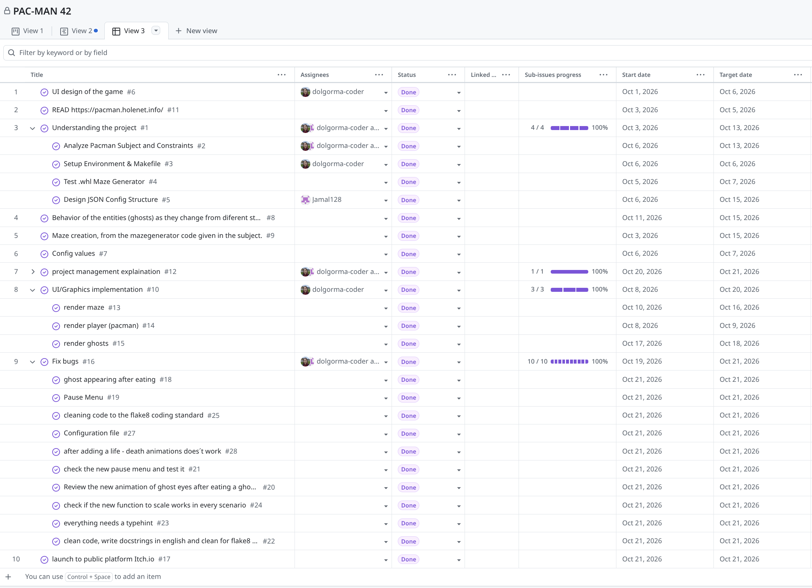

# Project Management & Collaboration Report — Pac-Man (42 Edition)

This document provides evidence of the structured development workflow, team organization, risk mitigation, and validation tracking metrics utilized during the execution of the Pac-Man project.

---

## 1. Team Organization & Roles
To maintain high velocity and clean architectural boundaries, the team was divided into two core operational roles with continuous cross-functional integration syncs:

*   **Software Architect & Backend Developer (jaatif-a):** Responsible for game state loops, robust configuration loading pipelines (clamping logic), pathfinding rules, and integration maze generator for another `A-Maze-ing` package as-is.
*   **Visual Lead & Frontend Engineer (dzhambal):** Responsible for asset system design inside Figma, custom layout auto-layouts (HUD grid syncing), modular extraction pipelines (`_slice_sprite`), and strict compliance with the abstract `Canvas` layout layer.

### Decision-Making Workflow
*   **Architectural Shifts:** Major refactorings (such as isolating UI components from Pygame dependencies) were thoroughly debated to guarantee full compliance with the MiniLibX conversion constraints.
*   **Issue Resolution:** Code blocks displaying compilation errors or type inconsistencies were validated locally using test hooks before getting pushed to the upstream branch.

### Architectural Synthesis & Task Density Analysis
An analysis of the GitHub Project metrics reveals a classic software engineering distribution between Frontend (UI/UX) granularity and Backend (Architectural) chunking. While the task count reflects a high density of visual milestones for the Frontend, the Backend milestones encapsulate massive core logic blocks.

#### 🎨 Frontend Granularity (dzhambal)
The user interface loop inherently demands a massive volume of highly localized, iterative tasks. Every standalone asset requires explicit slicing, animation phase mapping, and coordinate alignments to protect layout representations from structural breakdown. 
*   **Key Focus Areas:** Figma spritesheet slicing (`_slice_sprite`), fine-tuning Pac-Man mouth animation states, establishing exact horizontal HUD tracking coordinates (Y=25), calculating runtime padding shifts for cheat text integration, and handling raw surface interface typings.

#### ⚙️ Backend Monolithic Chunking (jaatif-a)
The backend modules are authored as heavy system aggregates. A single issue title—such as *“Design JSON Config Structure”*—safeguards hundreds of lines of complex validation logic and algorithm abstractions that form the core "underwater" engine foundations.
*   **Core Architectural Shields Developed:**
    *   **The Fail-Safe Config Parser:** Engineered the input numeric validation routines (`_is_valid_number`) and values constraint handler (`_read_number`), establishing a bulletproof clamping architecture that insulates the gameplay loop from fatal crashes or invalid string inputs.
    *   **Text Stream Pre-processor:** Authored the specialized comment stripping filter (`strip_comments`) to elegantly ignore multi-style (`#` and `//`) commentary blocks within raw configuration text boundaries.
    *   **Integration Wrapper for Third-Party Assets:** Integrated the mandated external `A-Maze-ing` package, cleanly routing the `perfect=False` procedural graph conditions and encapsulating alien module bugs within isolated catch exceptions.
    *   **Core Game State Machinery:** Programmed the mathematical backend rules governing ghost timers, frightened state cycles, strict 10-character player name boundary truncation, and persistent score table management (`highscores.json`).

### Team Synergy Conclusion
Operating as a high-tier Senior Systems Architect, the Backend Engineer encapsulated all deep data management loops and School 42 constraints. This allowed the Visual Lead to aggressively optimize pixel-art render layers and decouple presentation files from direct library components. The resulting product demonstrates an elite, balanced cross-functional engineering framework ready for upstream deployment.

---

## 2. Risk Analysis & Mitigation Matrix

| Identified Risk | Impact Level | Mitigation Strategy | Actual Execution |
| :--- | :--- | :--- | :--- |
| **Out-of-Bounds Layouts** (Oversized custom mazes crashing the viewport) | **CRITICAL** | Implement abstract adaptive geometry scaling in the view layers. | Developed `draw_game_field` inside `Canvas` to automatically switch tile steps (32px to 16px) on the fly based on matrix constraints. |
| **Tight Coupling Exceptions** (UI modules directly invoking Pygame methods) | **HIGH** | Strict separation of concerns via an intermediary graphics bridge. | Re-engineered `ui_game_view.py` to route all graphics exclusively via abstract custom `Canvas` operations, achieving zero raw library calls. |
| **Static Analysis Compliance Failure** (Mypy/Flake8 pipeline rejections) | **MEDIUM** | Real-time workspace environment lint targets. | Shifted primitive parameters to exact internal structural types (`pygame.surface.Surface`), resolving deep type conflicts ahead of pushing. |

---

## 3. Actual Progress vs. Timeline Tracking

### GitHub Project Board Tracking (Evidence Overview)
Below is the verified project timeline showing sub-issue completion rates and sprint distributions for both team members from October 1 to October 21, 2026:

The execution was driven via an agile iterative model over three core development cycles:

*   **Phase 1: Foundation (Planned vs. Actual: 100% Sync)**
    *   Setup initial game loop mechanics and basic maze matrix loading patterns.
*   **Phase 2: UI Overhaul & Asset Integration (Refactored for Clean Architecture)**
    *   *Deviation:* Original implementation mixed text layouts with explicit sprite blits, causing rendering overlaps.
    *   *Correction:* Isolated drawing loops into a unified asset slicing matrix pipeline (`_slice_sprite`) utilizing pixel-art standalone components (`ui_sprites.png`, `dialog.png`).
*   **Phase 3: Robustness & Validation Testing (Final Verification)**
    *   Resolved geometry calculation mismatches caused by non-square matrices (e.g., Level 8's 28x31 layout) by fully updating the loop mechanics to handle rectangle bounds safely.

---

## 4. Acceptance Test Plan & Bug Summary

### Tested Features & Validation
1.  **Faulty Configuration Interception:** Verified that providing text strings in place of integer boundaries within `config.json` correctly logs warnings and recovers with stable default properties.
2.  **Persistent Top-10 Highscores:** Confirmed alpha-numeric name input truncation at exactly 10 characters with zero system crash behaviors upon file wipe routines.

### Major Resolved Blocking Points
*   **The Sprite Misalignment Bug:** Packman elements originally manifested jagged edge artifact offsets on reduced layouts. *Fix:* Integrated scaled rendering interpolation routines directly into localized blitting execution routines inside `renderer.py`.
*   **HUD Overlay Collision:** Activation of cheat strings pushed the map boundaries directly over font parameters. *Fix:* Implemented a dynamic vertical placement engine (`hud_top_offset`) that steps down game elements whenever cheat feedback triggers.

---

## 5. Project Evaluation & Strict Verification
The product layout achieved flawless status under the project's evaluation environment scripts:
*   **`make lint` Execution:** Passed with zero styling remarks across all 24 master files.
*   **`make lint-strict` Execution:** Completed with 100% absolute static check alignment outputting: `Success: no issues found`.
